# Anime Art Coach — Teaching a language model to draw with algorithms

[简体中文](README.md) · English

Anime Art Coach processes an existing anime illustration on your own computer. Give it a PNG or JPG and it returns a render at the original size, along with separate color, shadow, highlight, and line layers you can inspect. You can run the Python renderer yourself or ask Codex or DeepSeek Harness (DSH) to run it and compare the results.

The project started with a practical question. Can you soften a long highlight on a leg and keep the bend of the knee? The same question applies at a smaller scale. A collar may read well with simpler shading, while losing two pink strokes can erase the face on a badge.

[Windows x64 portable download](https://github.com/davidd4242/anime-art-coach/releases/download/windows-v1.0.0/anime-art-coach-windows-x64.zip) · [Codex download](https://github.com/davidd4242/anime-art-coach/releases/download/v1.0.0/anime-art-coach-codex.zip) · [DSH download](https://github.com/davidd4242/anime-art-coach/releases/download/v1.0.0/anime-art-coach-dsh.zip) · [Releases and checksums](https://github.com/davidd4242/anime-art-coach/releases)

## Two illustrations, before and after

In both figures, **the left column shows the original transparent PNG and the right column shows the finished image supplied by the user**. Both appear at the same height on white, with matching crops underneath. The delivered images were resized and JPEG-compressed. For pixel-level comparisons, use the full-size input and the renderer’s PNG output.

### Case 1

Look at the blue fabric just above and to the left of the black lacing. In the original, a bright lip along the collar darkens gradually into the fabric. The finished image flattens that transition. The triangular opening at the top and the square opening below are still legible. A separate, optional export for this particular portrait restores some of the original collar shadow.

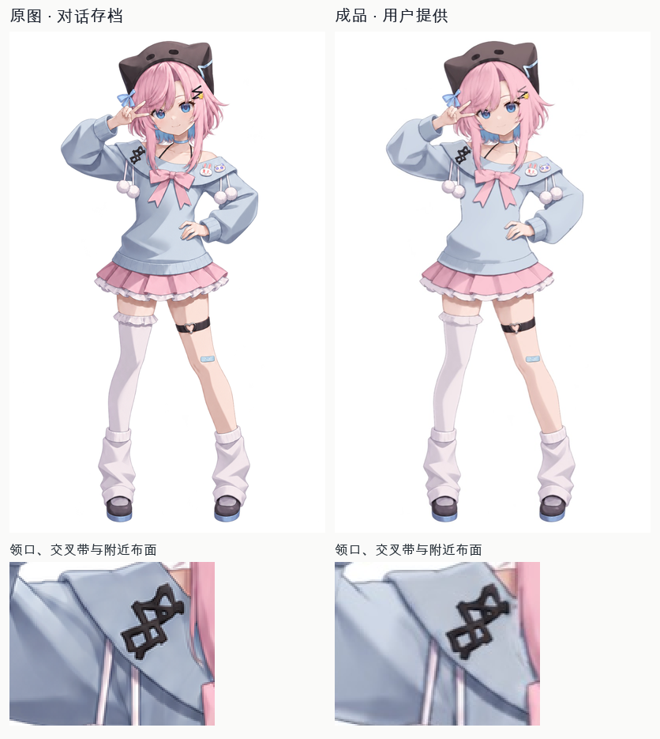

### Case 2

Follow the front leg from the garter to the knee. Softening the long highlight gives the lit side of the leg a more continuous shape. The change of plane at the knee and the shadow on the rear leg still give the pose depth. Then look back at the gold stars against the navy garter. Those small shapes matter just as much as the broad areas of skin.

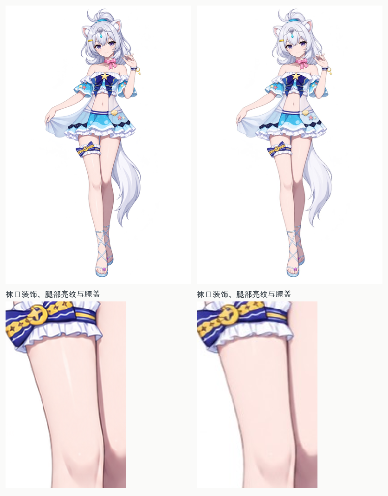

## Choose an edition

| Edition | Use it when | What you get |
|---|---|---|
| Windows x64 portable | You want to select or drop an image and render offline | Bundled Python and CPU dependencies, plus launchers for rendering and review |
| Codex | You work with a coding assistant or want a simple Python command | Rendered PNG, separate layers, protection masks, and a run report |
| DSH | You want an assistant to check specific details at known coordinates | The same renderer, plus a location grid, numerical differences, and side-by-side crops |

Local rendering needs no API key. Calling an online model to interpret DSH’s review material uses your own DSH configuration.

### Windows quick start

On Windows 10 or 11 with a 64-bit Intel or AMD processor, extract the entire portable ZIP. Double-click **Run.cmd** to select an image, or drop one image onto the launcher. Open `runs\<run ID>\pass-1\result.png` for the result. Use **Review.cmd** for the grid and detail crops. The released ZIP passed a native Windows Server 2022 x64 test using its bundled interpreter to run both modes for two passes. [Windows test run](https://github.com/davidd4242/anime-art-coach/actions/runs/45244488990) · [Windows guide (Chinese)](windows/README.md)

### Python quick start

On macOS or Linux, extract your edition and open a terminal in the directory containing `requirements.txt`. The release was installation-tested in a clean macOS arm64 environment with Python 3.9.6.

```sh
python3 -m venv .venv
. .venv/bin/activate
python -m pip install -r requirements.txt
```

Put your original image in the project directory as `input.png`, or substitute its path. Run the command for your edition.

```sh
# Codex
python adapters/codex/run.py input.png runs/first

# DSH
python adapters/dsh/run.py input.png runs/first
```

Open `runs/first/pass-1/result.png`. Compare the whole figure at the same display height before zooming in. Choose a new output directory for each run so you can revisit earlier results.

## How the renderer works

1. **Read the canvas.** The renderer reads RGB and alpha separately. It distinguishes transparent portraits, white paper backgrounds, and full scenes, then estimates materials using color, neighboring regions, and brightness. White balance is adjusted only when there is enough neutral background to support it.
2. **Separate the paint layers.** The shadow multiplies the base color. Highlights are screened over the result, then the ink layer is composited using its opacity. This lets the renderer soften a narrow highlight while keeping a nearby cast shadow.
3. **Treat different lines differently.** A silhouette, a seam between two materials, and a fold inside one piece of fabric have different jobs. The fold analysis follows the main direction of a crease, finds its sides, and tapers it toward its ends. Hair, belts, and cuffs have their own handling.
4. **Recover small marks.** The renderer compares a provisional result with the source to find lost strokes, low-contrast prints, repeated motifs, and curved metal rims. Where protection applies, it restores a weighted contribution from the original layers.
5. **Keep a record.** Each pass writes the render, its component layers, diagnostics, and a report. In a two-pass run, the second pass reads the first pass’s actual output and checks the associated protection mask against its recorded hashes.

The daily preset is `artist` at strength `1`, with automatic detail protection enabled and optional denoising off. If a fabric or skin region looks too flat, try a lower strength from the original, for example `python scripts/redraw.py input.png -o runs/gentler --strength 0.65`. [Parameter and denoising guide (Chinese)](docs/USAGE.md)

## Read the diagnostic images

These full-size maps come from the first pass. Click an image to inspect individual strokes.

| Case 1 · Shadow extracted from the source | Case 1 · Shadow after processing |
|:---:|:---:|
| [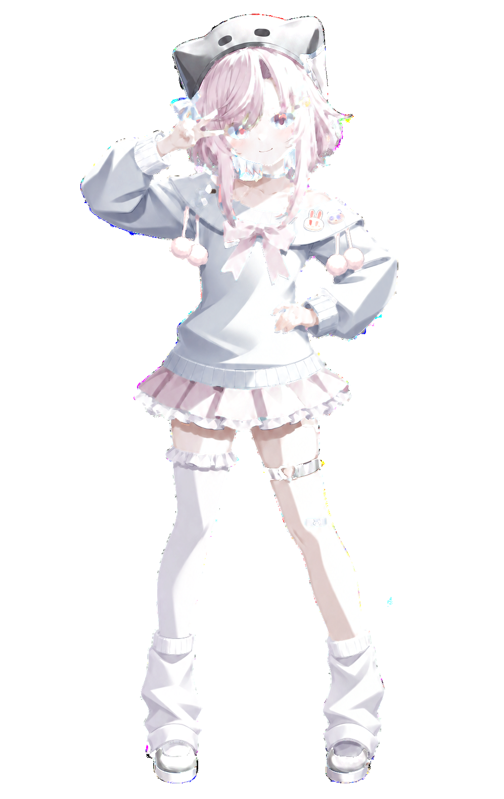](examples/maps/case-1-source-shadow.png) | [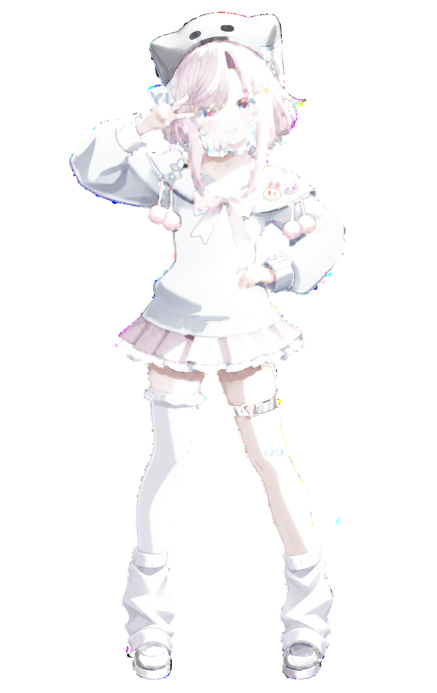](examples/maps/case-1-render-shadow.png) |

Compare the raised sleeve, then the collar edge and skirt folds. White in a multiply-shadow layer leaves the base color at its original brightness. Darker values darken it more.

| Case 2 · Detected lines | Case 2 · Classification of detected lines |
|:---:|:---:|
| [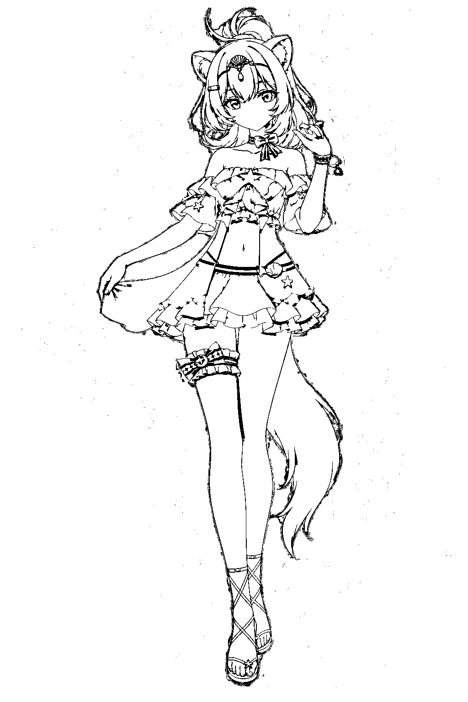](examples/maps/case-2-line-mask.png) | [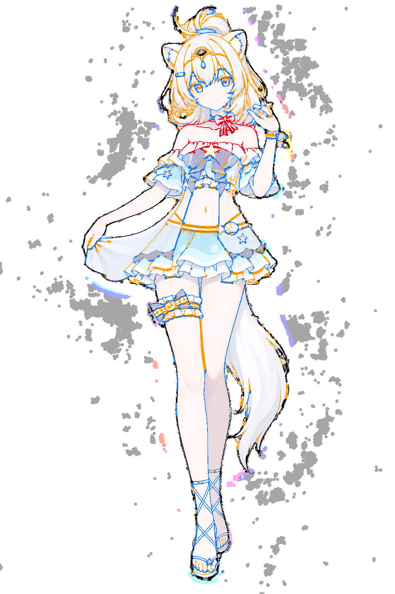](examples/maps/case-2-line-tiers.png) |

Follow the skirt hem or a sandal strap across both images. On the left, black marks detected lines. On the right, black denotes silhouettes, red facial lines, blue material boundaries, and orange lines within a material.

### An independent depth estimate for Case 2

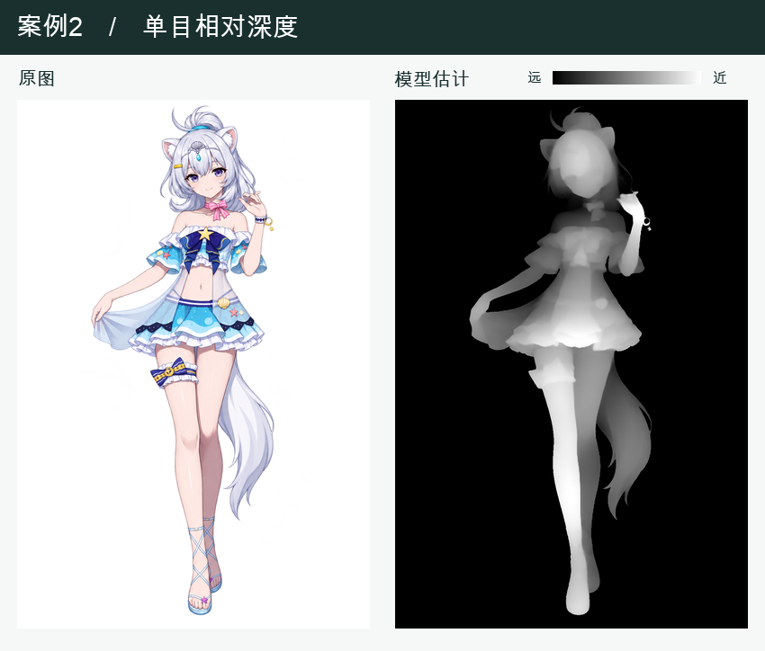

The model places the overlapping front leg closer than the rear leg. Depth along the tail is more ambiguous. Brightness ranks estimated distance within this image, and black marks the background.

This illustration was run separately through Depth Anything V2 Small. The input was composited on white and preprocessed with a 518-pixel short side. The prediction was resized to 1024 × 1536 using bicubic interpolation. Values between the 1st and 99th percentiles of foreground pixels (alpha ≥ 128) were stretched linearly, with the extremes clipped. In the 16-bit PNG, 0 marks the background and 1–65535 runs from far to near. The daily renderer uses its own 2D layers. [16-bit depth PNG](examples/maps/case-2-relative-depth.png) · [Exact model revision](https://huggingface.co/depth-anything/Depth-Anything-V2-Small-hf/tree/5426e4f0f36572d16453bbda7a8389317b1bef99)

## Inspect details at matching coordinates

In the six guides below, the green rectangle locates the crop on the original PNG. The middle panel shows the original and the right panel the delivered result. Both crops are enlarged from the same display scale. The coordinates printed below them refer to the full-size input.

**Case 1 · Is the black strap broken, or did the blue cloth inside the opening get lighter?** Trace the edges around the triangular and square openings. If both shapes close and the crossing is still connected, record the cloth change separately.

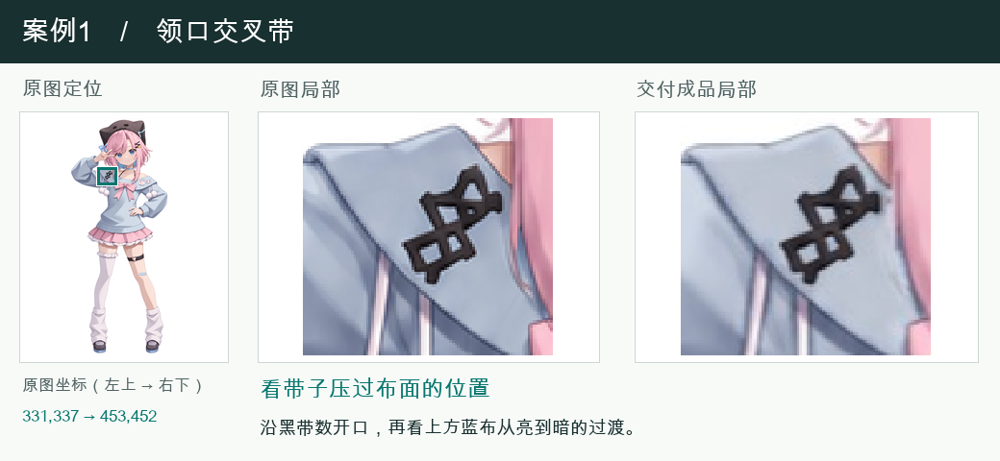

<details>
<summary>Case 1 · Pink badge marks and the face on the bandage</summary>

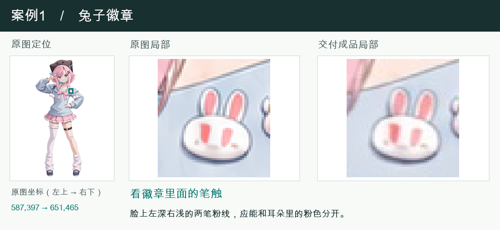

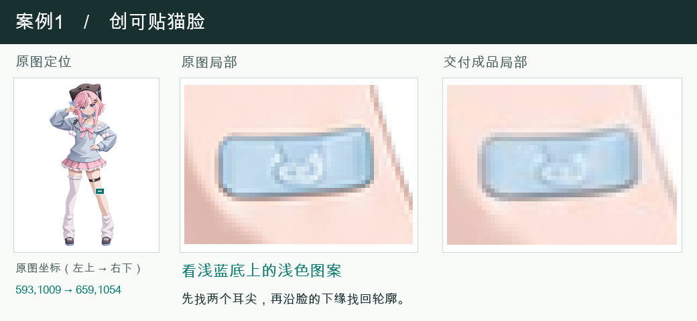

</details>

**Case 2 · Can you tell which leg is in front after the highlight is softened?** Compare the long stripe with the turn beneath the knee and the darker plane of the rear leg.

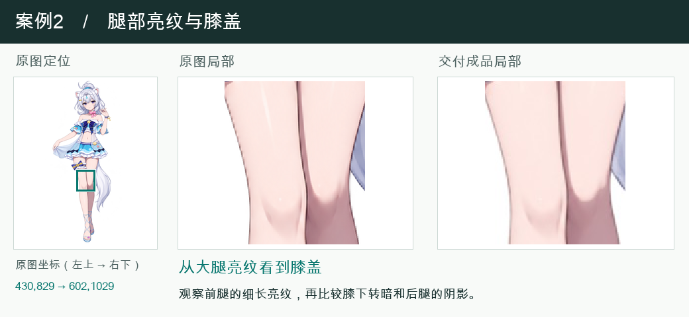

<details>
<summary>Case 2 · Shells at the hem and gold motifs on the garter</summary>

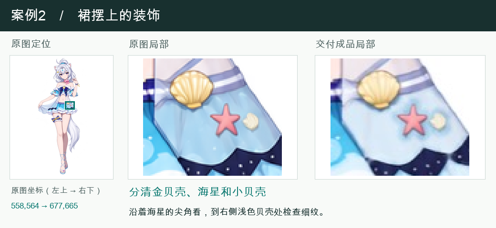

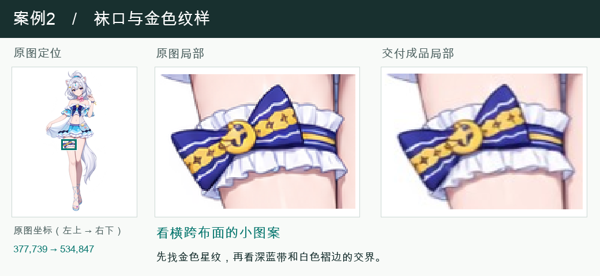

</details>

**What did the algorithm actually select?** Case 1 matches a previously reviewed protection mask. Its white region covers the badge and both pink marks. A new portrait goes through automatic selection and can produce a different mask.

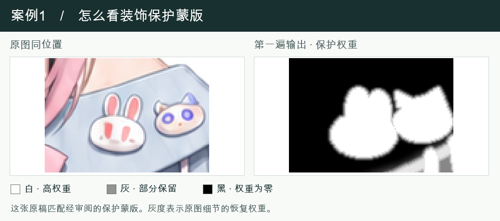

In Case 2, trace the blue boundary across the skirt panels, then look at the orange lines inside the ruffles. If a fold becomes too faint, this view can help explain how it was classified.

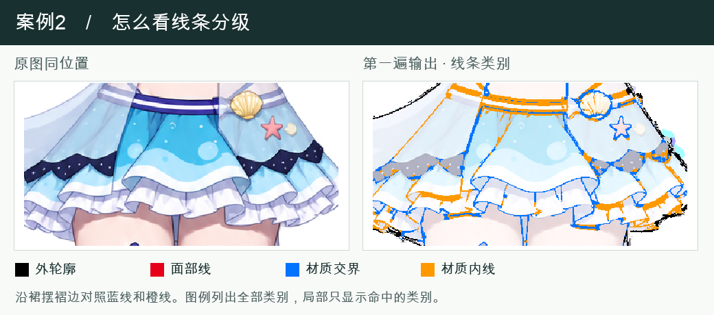

## Ask an assistant to review a render

DSH divides the source into four columns and six rows. By default it shows the three visible cells with the largest mean absolute RGB changes. A small badge can occupy too few pixels to rank highly, so you can also supply explicit crop boxes.

For this example, save the [original Case 1 PNG](examples/momo.png) as `input.png` (997 × 1578). The boxes cover the face on the bandage, the rabbit badge, and the black lacing, in that order. Coordinates are measured from the top left as `left top right bottom`, with the right and bottom edges excluded.

```sh
python adapters/dsh/run.py input.png runs/detail-check --passes 2 \
  --crop 595 1011 655 1049 \
  --crop 592 402 647 462 \
  --crop 370 350 437 425
```

Open `crop-01.png` through `crop-03.png` in `runs/detail-check`. Each shows the original, pass one, and pass two from left to right. A useful review prompt is:

> Compare the full figure first. In the crops, check the ear tips and dots on the bandage, the two pink marks on the badge, and the openings in the lacing. For each detail, name the crop and the first pass where you can see a change. Mark anything too small to judge. Give your full-figure preference separately. A tie is a valid result.

An assistant with file access alone can verify dimensions, alpha, provenance, and crop coordinates. A person can then inspect the crops. Mean pixel change tells you where to look. [Codex workflow (Chinese)](adapters/codex/OPERATIONS.md) · [DSH workflow (Chinese)](adapters/dsh/OPERATIONS.md)

## Output files

| File | What to inspect |
|---|---|
| `pass-1/result.png`, `pass-2/result.png` | The complete render after each requested pass |
| `layer_flat.png`, `layer_shadow.png`, `layer_highlight.png`, `layer_lines.png` | The four processed layers in each pass directory. Compare with the matching files under `original_layers/`. |
| `debug_detail_protect.png` | Local weights used to preserve original detail |
| `report.json` | Source, settings, protection mode and timing. Check for local paths before sharing it. |
| `grid.png`, `evidence.json`, `crop-*.png` | DSH’s location grid, change measurements and aligned crops in the run’s top-level directory |

## How examples improve the rules

Development used human-drawn references, 122 illustrated cards, and blind full-figure comparisons. A long highlight on a softly lit leg can be redundant, while a similar mark in strong backlight can convey volume. An actionable annotation records the coordinates, material, light direction, and the stroke’s purpose.

To change a rule, reproduce a failure and pair it with a similar detail that should survive. Change one condition, rerun both passes, then evaluate on works held out from tuning. Record improvements, ties, and regressions separately. New samples reveal gaps and can guide a tested change. Adding files to a folder does not update any model weights. [Illustrated iteration method (Chinese)](docs/METHOD.md)

## Validation

- Both downloadable agent editions were unpacked and run. For Case 1, the rendered images, shadow layers, and detail-protection masks from both passes matched the approved baseline pixel for pixel.
- Both original portraits were checked through two passes. The validation record includes dimensions and decoded RGBA hashes so you can repeat the comparison in a matching environment. Alpha was checked separately.
- Synthetic fixtures exercise resizing, mirroring, mask precedence, and repeated processing. Human reviewers judge full figures blind and can choose a tie before inspecting crops.
- Both assistants call the same renderer. Their ability to recognize defects or judge an illustration is a separate question. The project has no head-to-head visual benchmark for DeepSeek V4.1 Flash and Astra 6.2.

[Validation and reproduction notes (Chinese)](docs/VALIDATION.md) · [Third-party software, weights and artwork (Chinese)](docs/THIRD_PARTY.md)

## A note from the author

Human illustrators are still needed to revise a picture and bring out its beauty. People see beauty differently, and AI cannot understand what beauty means to us. Those differences in how we see are part of what gives each artist a distinctive style. Please use this project as a tool and leave the artist’s place to the artist.
