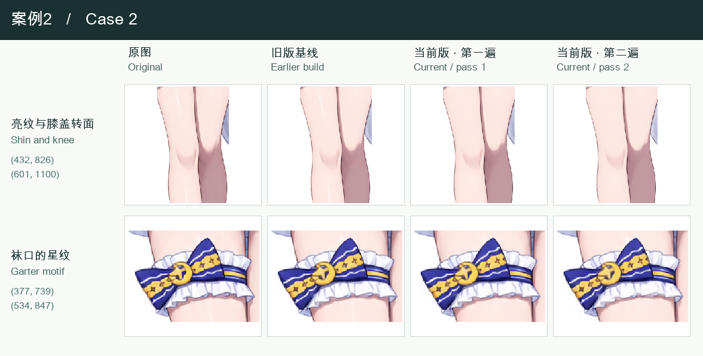

# Anime Art Coach：用算法精修动漫立绘

简体中文 · [English](README.en.md)

**减淡一条多余的亮纹，别把膝盖的转面也抹掉。** Anime Art Coach 是一套本地立绘后处理与视觉复核工具：输入已有的 PNG 或 JPG，输出原尺寸 PNG，并把底色、阴影、高光和描线分开，方便回看每一处改动。

可以直接用 Python 运行，也可以让 Codex 或 DeepSeek Harness（DSH）运行工具、定位局部、对照结果。默认渲染在本地 CPU 上完成，不需要 API 密钥，不会训练模型，也不提供从文字生成新图的功能。

## 下载和运行

| 版本 | 适合谁 |
| --- | --- |
| [Windows x64 便携版](https://github.com/davidd4242/anime-art-coach/releases/download/v1.0.1/anime-art-coach-windows-x64.zip) | 想直接拖图处理，不想单独安装 Python |
| [Codex 版](https://github.com/davidd4242/anime-art-coach/releases/download/v1.0.1/anime-art-coach-codex.zip) | 想用命令行或让 Codex 运行，查看成图、图层、保护蒙版和报告 |
| [DeepSeek Harness 版](https://github.com/davidd4242/anime-art-coach/releases/download/v1.0.1/anime-art-coach-dsh.zip) | 需要定位网格、变化读数和同位置裁片，方便逐项复核 |

以上为 v1.0.1。[所有版本与校验文件](https://github.com/davidd4242/anime-art-coach/releases)

**Windows 10/11（Intel 或 AMD 64 位）：** 完整解压便携包，双击 `Run.cmd` 选图，或把图片拖到它上面；用 `Review.cmd` 额外生成网格和裁片。成图位于 `runs\本次编号\pass-1\result.png`。[Windows 使用说明](windows/README.md)

**macOS / Linux：** 在解压后的项目根目录打开终端，将原稿命名为 `input.png`，或替换为实际路径。透明立绘建议使用原始 PNG。

```sh
python3 -m venv .venv
. .venv/bin/activate
python -m pip install -r requirements.txt

# 按所下载的版本，任选一条
python adapters/codex/run.py input.png runs/first
python adapters/dsh/run.py input.png runs/first
```

打开 `runs/first/pass-1/result.png`。先将成图与原稿缩到相同显示高度看整张，再放大看细节。默认只跑一遍，每次使用新的输出目录。想让改动轻一点，可用 `python scripts/redraw.py input.png -o runs/gentler --strength 0.65`。[完整操作与参数](docs/USAGE.md)

## 看哪里变了，哪里没变

**腿部亮纹、膝盖和袜口。** 第一遍从五处候选亮纹中处理了两处，第二遍没有再选中亮纹。这个数字说明规则何时介入；膝盖转面、后腿投影和袜口的金色纹样有没有保住，要看图。下图从左到右是原稿、早期基线、当前版第一遍和第二遍。



**领口、穿绳孔和兔子徽章。** 早期版本减弱明暗时，也压淡了徽章脸上的两笔粉线。当前版用这张已审阅原稿的专用蒙版恢复细节。这个例子展示了保护机制的作用，不代表新图也能自动识别同类细节。[打开四栏局部对照](examples/iteration/case-1-regression.png)

想看全身效果：[领口案例](examples/momo-compare.png) · [腿部案例](examples/starfish-compare.png)。这两张展示图左边是透明 PNG 原稿，右边是用户提供的交付成品，曾缩放和压缩为 JPG；右栏不是脚本的直接输出，不能用来做逐像素验证。

## 算法处理什么

1. **识别区域与线条。** 根据透明度、颜色、亮度和邻接关系估计材质，并区分外轮廓、材质交界和材质内部的线。
2. **拆开光影再调整。** 将底色、乘法阴影、滤色高光和透明描线分别处理，让一条亮纹可以变淡，同时保留附近的遮挡暗边。
3. **回看可能被削弱的细节。** 对照原稿与临时合成，按保护权重保留原图中的细线、浅色印记和小纹样，输出成图和检查依据。

`pass-1` 中的 `result.png` 是成图，`layer_*.png` 是四个图层，`debug_detail_protect.png` 显示细节保护权重，`report.json` 记录运行参数和本机路径，公开分享前请先检查。

[分层、规则和样本迭代](docs/METHOD.md) · [阴影分解](examples/maps/case-1-source-shadow.png) · [线条分级](examples/maps/case-2-line-tiers.png) · [独立单目相对深度示意](examples/maps/case-2-depth-view.png)。相对深度图是单独实验，日常渲染仍使用二维分层。

## 怎样交给助手复核

可以这样交代：「先看整图，再对照同位置裁片。只检查三件事：膝盖转面还在不在、后腿是否仍在暗面、袜口星纹能不能辨认。每条注明依据哪张图，看不清就写‘待人工核对’。」

DSH 版可用 `--crop 左 上 右 下` 指定原图像素坐标，并输出 `grid.png`、`evidence.json` 和裁片。变化读数只能帮你定位，不能判断哪张更好看。在线模型复核是可选的，是否能读图和是否产生用量取决于你的 DSH 配置。

[Codex 操作书](adapters/codex/OPERATIONS.md) · [DSH 操作书](adapters/dsh/OPERATIONS.md)

## 验证和局限

- 两张公开原稿各跑过两遍，核对了尺寸、透明通道和原尺寸 RGBA 像素摘要。v1.0.1 便携包也用内置解释器通过了 [Windows x64 CI](https://github.com/davidd4242/anime-art-coach/actions/runs/45244488990)。
- 强逆光和镜面金属上的亮边可能正是交代体积和材质的笔触。遇到新画风，先看原稿和默认结果，再决定是否减弱强度或使用局部蒙版。
- 样本用来找问题、调整规则和检验能否推广，不会自动训练模型。两个入口使用同一渲染内核，不代表不同助手的视觉判断能力相同；项目没有验证商业模型之间的在线识图排名。

[验证记录与复跑](docs/VALIDATION.md) · [第三方组件、可选权重与素材说明](docs/THIRD_PARTY.md)
