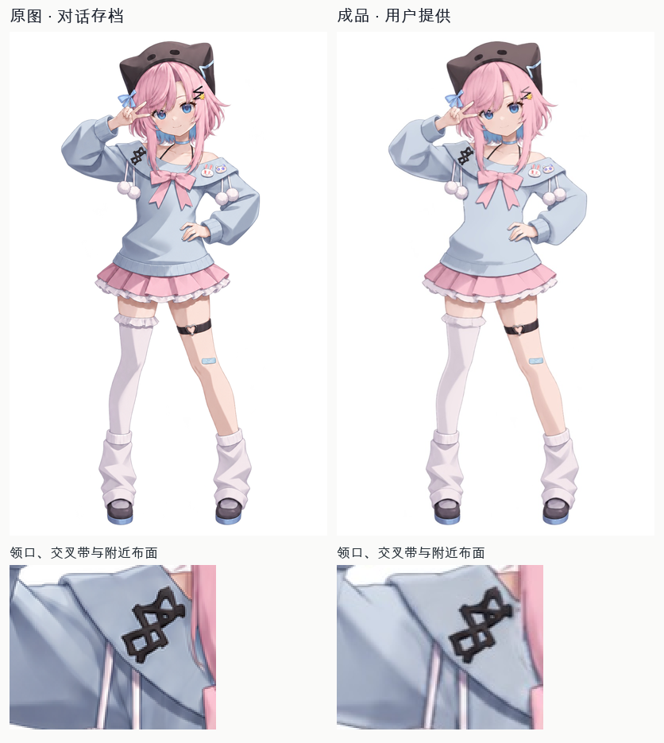
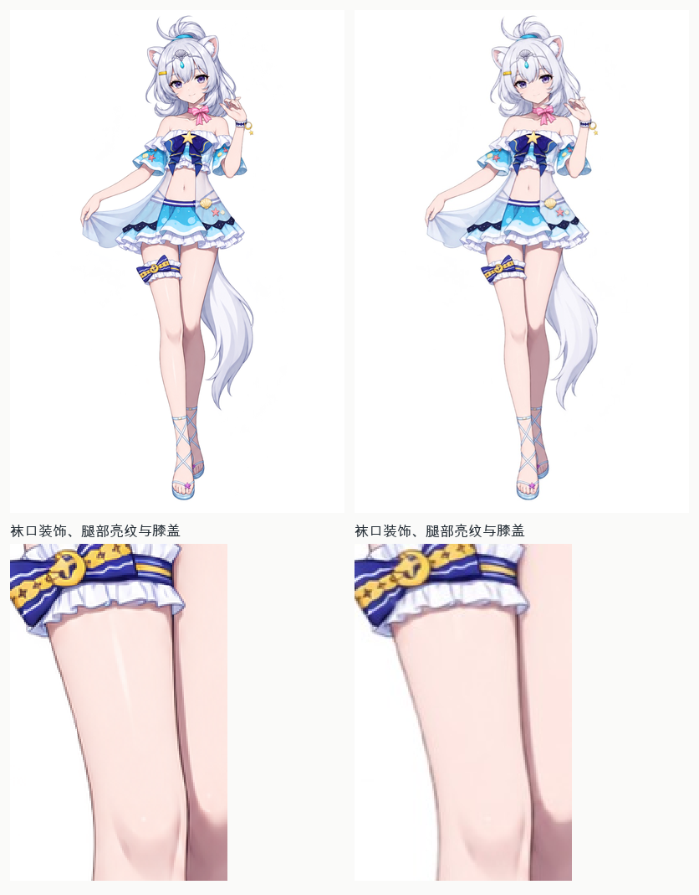
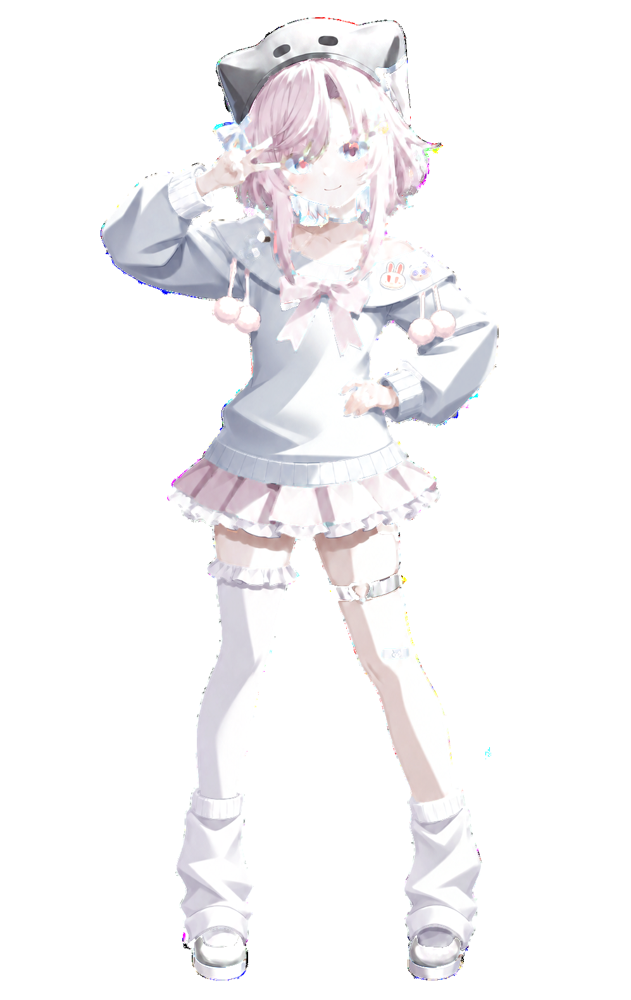
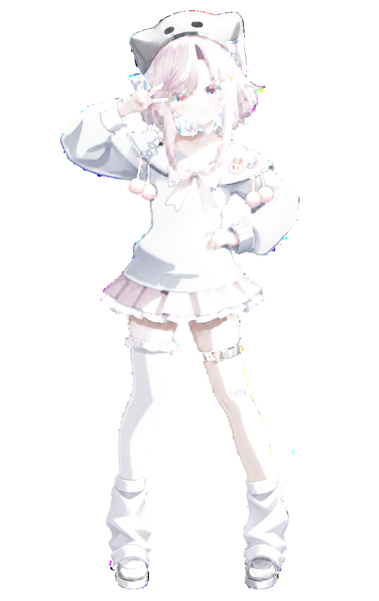
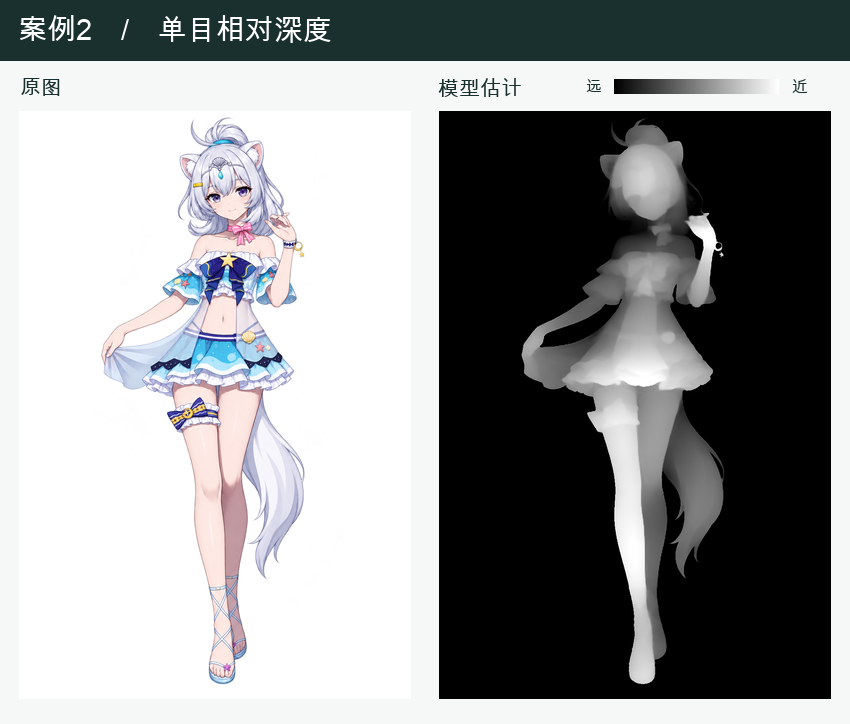
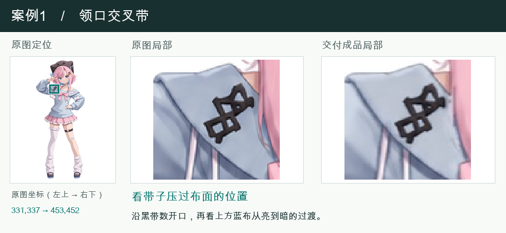
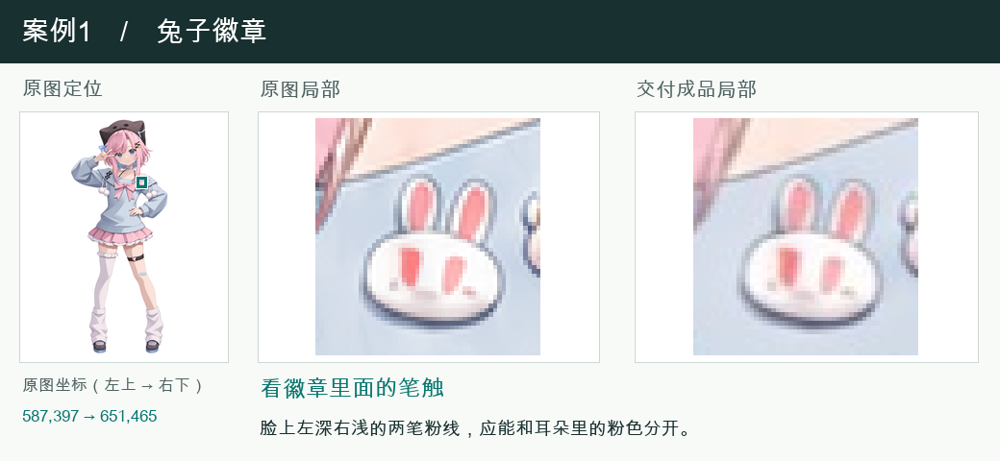
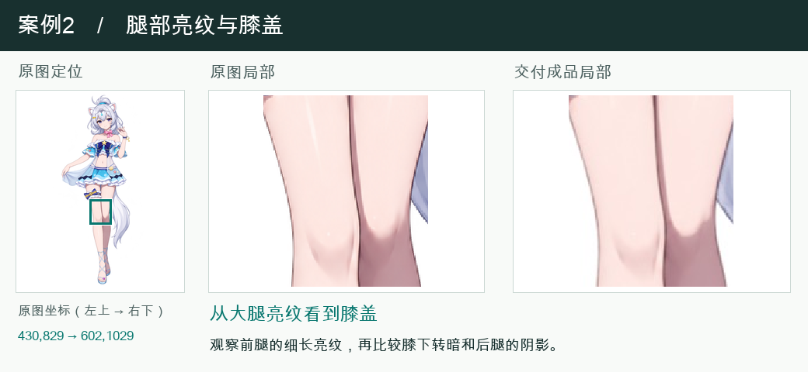
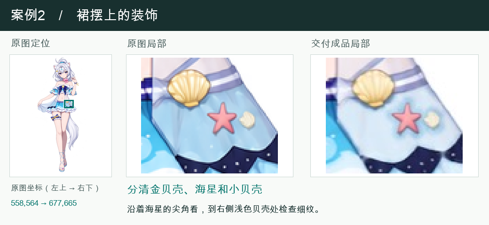
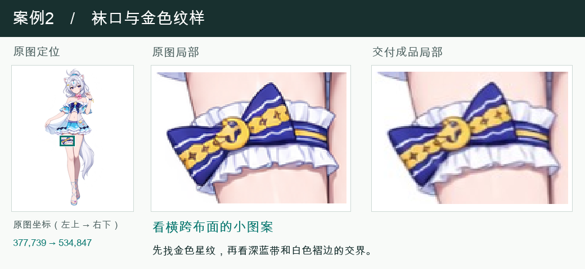

# 降低ai味—用算法教导你的大模型学会画画

这是一个在本地运行的动漫立绘后处理工具。给它一张已有的 PNG 或 JPG，它会分析底色、描线、阴影和高光，输出同尺寸成图和可检查的图层。你可以自己运行，也可以让 Codex 或 DeepSeek Harness 代为处理、裁切和对照。

项目从一个具体问题出发：一张立绘的腿上有几条重复长亮纹，可以合并成较大的受光面，但膝盖的转折、两条腿交叠的投影仍要保住。同样，领口布料可以画得简洁，衣服上的穿绳孔和徽章笔触却可能只有几像素宽。这套算法把这些部位分开处理，最后把判断交给看图的人。

[Windows x64 便携版](https://github.com/davidd4242/anime-art-coach/releases/download/windows-v1.0.0/anime-art-coach-windows-x64.zip) · [下载 Codex 版](https://github.com/davidd4242/anime-art-coach/releases/latest/download/anime-art-coach-codex.zip) · [下载 DSH 版](https://github.com/davidd4242/anime-art-coach/releases/latest/download/anime-art-coach-dsh.zip) · [版本与校验文件](https://github.com/davidd4242/anime-art-coach/releases/latest)

## 先看实际效果

两组对照的**左栏是最初提交的透明 PNG 原图，右栏是用户提供的最终交付成品**。为了方便比较，两栏采用相同显示高度和白色底，下面的局部取自同一位置。右栏来自经过缩放、压缩的 JPG。需要做像素级复测时，请使用原尺寸 PNG 和脚本直接输出的 PNG。

### 案例1

先看黑色交叉带左上方的蓝布。原图里，领口上沿有一条亮边，往下逐渐转暗；成品把这块明暗收得更平。再看交叉带，上方的三角孔、下方的方孔和中间那段交叠仍能区分。这个局部也体现了一种取舍：想多留一点布料厚度时，可以只在领口补回部分原阴影。这个版本作为单图选项单独导出。



### 案例2

先沿前腿从袜口看到膝盖。原图的长条亮纹吸引视线，成品把它减弱后，前腿较大的受光面更连贯。膝盖附近还有转面，后腿仍压在较暗的一侧。最后回头看袜口：金色星纹和周围深蓝色带共同构成装饰，能否辨认这些小形状，是和肤色处理同等重要的检查项。



## 全身线条识别与阴影分层

下面四张直接取自日常预设第一遍的原尺寸输出，点击图片可以放大检查。

**案例1 · 阴影分层。** 先比抬起的袖子，再看领口下沿和裙褶。左图是算法从原稿分解出的阴影层，右图是处理后的阴影层。两幅都是乘法阴影：越接近白色，对底色的压暗越少。这里的明暗描述上色强度；这组输出没有记录像素到相机距离的几何深度图。

| 从原稿分解的阴影 | 处理后的阴影 |
|:---:|:---:|
| [](examples/maps/case-1-source-shadow.png) | [](examples/maps/case-1-render-shadow.png) |

**案例2 · 线条识别。** 左图用黑色标出检测到的线条。可以沿头发外缘、裙摆和鞋带逐段追踪。右图按程序的判断着色：黑色为外轮廓，红色为面部线，蓝色为材质交界，橙色为同一材质内部的线。浅色底图用来定位。检查一条衣褶被弱化的原因时，可以先在左图找这段线，再到右图看它被归入哪一类。

| 黑白线条检测 | 彩色线条分级 |
|:---:|:---:|
| [](examples/maps/case-2-line-mask.png) | [](examples/maps/case-2-line-tiers.png) |

### 案例2 的单目相对深度



沿小腿往下看，模型把交叠处的前腿估得更近，右侧后腿较暗。尾巴的中段亮度有变化，尤其是后腿附近，单张插画对距离的约束有限。图中的远近只在这张图内比较，黑色背景表示没有前景读数。

这张图用独立的 Depth Anything V2 Small 从案例2的原始透明 PNG 推理生成。输入先合成白底，使用官方预处理器（短边 518），预测结果经双三次插值还原为 1024 × 1536。用原始透明度 ≥ 128 的前景像素取第 1 至第 99 百分位做线性拉伸，超出范围的读数截到端点。16 位图中 0 留给背景，1 至 65535 由远到近。日常绘图流程仍使用原有的二维分层。[下载原尺寸 16 位深度 PNG](examples/maps/case-2-relative-depth.png) · [模型与本次所用版本](https://huggingface.co/depth-anything/Depth-Anything-V2-Small-hf/tree/5426e4f0f36572d16453bbda7a8389317b1bef99)

## 局部识别示意图

前六张图的绿色框标出**原始 PNG 上的取样位置**。中栏是原图局部，右栏是交付成品的同一位置。两栏先对齐到交付图的显示尺寸，再等倍率放大；边缘清晰度也会受到 JPG 压缩影响。图下坐标按原图像素给出，可直接用于 DSH 的 `--crop 左 上 右 下`。

**案例1 · 黑带断了，还是孔里的布变亮了？** 沿着上方三角孔的黑边看一圈，再看下方方孔。如果开口仍闭合、交叉处仍相连，孔内蓝布变亮可以单独记录。



<details>
<summary>案例1 · 展开兔子徽章和创可贴猫脸两张识别图</summary>




</details>

**案例2 · 亮纹变弱后，腿的前后关系还在吗？** 先看前腿上纵向的浅色亮纹，再把视线移到膝盖及后腿的暗面。同一个裁片就能分别判断亮纹和体积。



<details>
<summary>案例2 · 展开裙摆海星与贝壳、袜口金色纹样两张识别图</summary>





</details>

### 对照算法实际识别了什么

以下两张取自原始 PNG 经日常预设处理**第一遍**时输出的调试文件。它们可以回答两个具体问题：

- **哪些区域获得了额外保护？** 案例1 的白色区域覆盖徽章主体，因此脸上的粉线即使很淡，也在保护范围内。这张原图匹配了经过审阅的蒙版，新图的自动选择结果可能不同。


- **算法怎样区分相邻的线？** 案例2 可以从腰带沿蓝线追到裙片交界，再到白色褶边找橙线。颜色表示程序给出的类别；遇到线条减弱过头，可从这里核对归类。


## 选哪个版本

| 使用场景 | 建议版本 | 运行后可以检查什么 |
|---|---|---|
| 已经在 Codex 中处理文件，希望用自然语言安排出图、复跑和对比 | Codex | 完整成图、四个图层、装饰保护蒙版、参数报告 |
| 使用 DeepSeek Harness，或者希望助手按坐标逐项检查细节 | DSH | 相同的渲染输出，另加全身网格、局部对照图、变化读数 |
| 自己写脚本，希望直接控制强度、预设或保护蒙版 | 任一版 | 两个包都包含相同的 Python 内核和命令行入口 |

两个版本的区别在操作和复核方式。在同一环境里用同一原图和参数，两个入口调用同一套渲染规则。日常渲染在本地 CPU 上完成，无需模型 API 密钥。若另行调用 DSH 的在线模型写复核意见，用量取决于自己的 DSH 配置。

## Windows 快速开始

下载 Windows x64 便携包后，右键选择“全部解压”，双击包根目录的 **Run.cmd** 选择图片，也可以把一张图片拖到它上面。成图在 `runs\本次编号\pass-1\result.png`。**Review.cmd** 会额外生成网格、变化读数和同位置裁片。包中已包含 Python 和日常 CPU 绘图依赖，适用于 Windows 10/11 Intel 或 AMD 64 位系统。[Windows 操作手册](windows/README.md)

## 第一次运行

**1. 准备环境。** 解压所选版本，进入能看到 `requirements.txt` 的目录。以下命令适用于 macOS / Linux。发行版在 macOS arm64、Python 3.9.6 的干净环境中做过安装验证。Windows 的解释器调用方式见[操作手册](docs/USAGE.md)。

```sh
python3 -m venv .venv
. .venv/bin/activate
python -m pip install -r requirements.txt
```

**2. 处理自己的第一张图。** 把原图放在项目根目录，命名为 `input.png`，或把命令中的路径替换成实际文件名。按下载的版本任选一条：

```sh
# Codex
python adapters/codex/run.py input.png runs/first

# DSH
python adapters/dsh/run.py input.png runs/first
```

**3. 打开结果。** 先看 `runs/first/pass-1/result.png`。把它和原图缩到相同高度，看第一眼注意到的部位，再放大看装饰。再次试验请换一个新的输出目录，这样每次结果都能找回。

## 一张图经过哪些处理

1. **识别画布和区域。** 程序读取颜色与透明度，区分透明立绘、纸白背景和完整场景，再按线条、邻近颜色和亮度变化估计皮肤、头发、衣料等区域。有足够中性背景参考时才尝试校正白平衡。
2. **分解颜色与光影。** 底色乘上阴影得到暗面，再叠加高光和带透明度的描线。分别处理这些层，才有机会减轻一条皮肤亮纹，同时留下附近的遮挡暗边。
3. **调整线条和折面。** 人物外缘、两件衣物交界、同一块布内部的褶线承担不同作用。衣褶沿主要方向寻找两侧边缘，在末端收窄。头发、皮带、袖口也有各自的处理条件。
4. **保护容易丢的小笔触。** 算法对照原图与临时合成，检查浅色印记、细线、重复纹样和金属弧边。确认某处细节被削弱时，按权重恢复原图层内容。回归样例包括浅色贴片里的脸、徽章上的短线、独立扣孔和细链环。
5. **输出可追溯的结果。** 成图、图层、保护蒙版和参数报告一起写入输出目录。连续处理时，第二遍读取第一遍的真实输出，再核对报告与蒙版是否匹配。

日常预设为 `artist`，强度为 `1`，自动装饰保护开启，额外降噪关闭。若某张图的布面或肤色被压得太平，可以从同一原图试跑较低强度，例如 `python scripts/redraw.py input.png -o runs/gentler --strength 0.65`。可选降噪的依赖、权重校验及局部蒙版用法见[详细操作手册](docs/USAGE.md)。

## 怎样让助手检查它画得怎么样

DSH 版会生成四列六行的定位网格。默认列出显示颜色平均变化最大的几个区域，适合发现整片衣料或肤色的变化。一个小徽章只占格子里的少数像素，格子平均值容易把它淹没；对这类细节，可以主动指定原图坐标。

下面的命令适用于**案例1 的 997 × 1578 原稿**。先点开[案例1 原尺寸 PNG](examples/momo.png)，保存为 `input.png`。三个框依次对应创可贴上的脸、兔子徽章和领口交叉带。坐标从左上角起算，顺序是左、上、右、下。

```sh
python adapters/dsh/run.py input.png runs/detail-check --passes 2 \
  --crop 595 1011 655 1049 \
  --crop 592 402 647 462 \
  --crop 370 350 437 425
```

打开 `runs/detail-check/crop-01.png` 到 `crop-03.png`。每张依次展示原图、第一遍、第二遍。可以直接给助手这条要求：

> 先看全身图，再逐张看裁片。创可贴检查耳尖和脸内浅点；兔子徽章检查两笔粉色短线；交叉带检查孔是否仍然张开、黑带是否相连。每项写明原图有什么、哪一遍发生变化、依据哪张裁片。看不清的部位标“待人工核对”。最后单独写全身更偏好哪个版本，允许回答“持平”。

如果助手只能读文件和数字，可以让它核对尺寸、透明度、输入来源和坐标，再由人看裁片。变化读数适合定位，不能单凭数值大小评定哪张更好看。[Codex 操作书](adapters/codex/OPERATIONS.md) · [DSH 逐步操作书](adapters/dsh/OPERATIONS.md)

## 输出文件怎么读

| 文件 | 能回答的问题 |
|---|---|
| `pass-1/result.png` | 第一遍的完整成图如何？ |
| `pass-2/result.png` | 使用 `--passes 2` 时，重复处理有没有继续削弱笔触？ |
| `layer_flat.png`、`layer_shadow.png`、`layer_highlight.png`、`layer_lines.png` | 同一遍的底色、阴影、高光和描线各发生了什么？这些文件在对应的 pass 目录内。 |
| `debug_detail_protect.png` | 哪些区域获得了较高的细节保护权重？ |
| `report.json` | 这一遍用了哪个输入、预设、强度和保护模式？分享前留意其中的本机路径。 |
| `grid.png`、`evidence.json`、`crop-*.png` | DSH 版的坐标、变化读数和同位置对照在哪里？这些文件在本次输出目录的顶层。 |

## 样本如何改善算法

开发过程中用人类画师参考图、122 张卡面和全身盲测来找规则的边界。例如，同样是腿上的长亮纹，在柔和光照里可能显得重复，在强逆光里却承担了光向和体积。只记录“这里太亮”无法指导下一次修改；需要同时标出材质、光照、原图坐标，以及希望保住的画法。

新增样本时，先挑出能复现的问题，再配一张画法相近、应当保留原效果的图。用同一参数出图，每次只改一个判断条件。最后在未参与调参的作品上检查，并分别记录改善、持平和退化。把更多图片放进目录不会自动更新规则或模型权重；样本的价值在于发现盲区，并检验修改能否推广。[算法原理与样本迭代](docs/METHOD.md)

## 已经验证了什么

- **两种发行包分别解压实跑。** 案例1 连续处理两遍，两个入口的成图、衣褶阴影层和装饰保护蒙版均与定版样张逐像素一致。
- **两张原稿均做过两遍复测。** 验证记录提供原尺寸和各遍的 RGBA 像素摘要，便于在匹配环境中核对。透明通道也单独比较。
- **程序检查与人工判断分开。** 合成样例用于检验镜像、缩放、蒙版优先级和重复处理。全身盲测则允许选择任一版本或持平，再用局部放大解释偏好。
- **弱视觉模型的收益要单独测。** 网格和操作书能让助手明确检查哪个位置、读取哪个文件。项目尚未对 DeepSeek V4.1 Flash 和 Astra 6.2 做在线识图对照，渲染结果一致不等于两者审美判断相同。

[验证过程与复跑方法](docs/VALIDATION.md) · [第三方组件、可选权重与素材说明](docs/THIRD_PARTY.md)

## 写在最后

这并不是取代人类画手，仍然需要人类画手对于图片进行修改和美化。美和美亦有差距，ai无法理解人类的美。人美和美的差距亦成就了画风的差距。请把它当成一个工具，而并非替代品。
