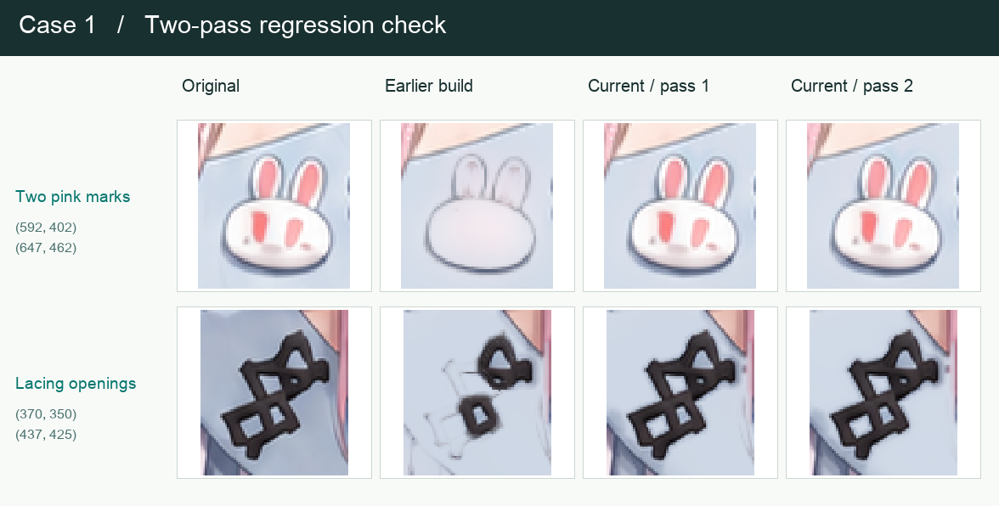
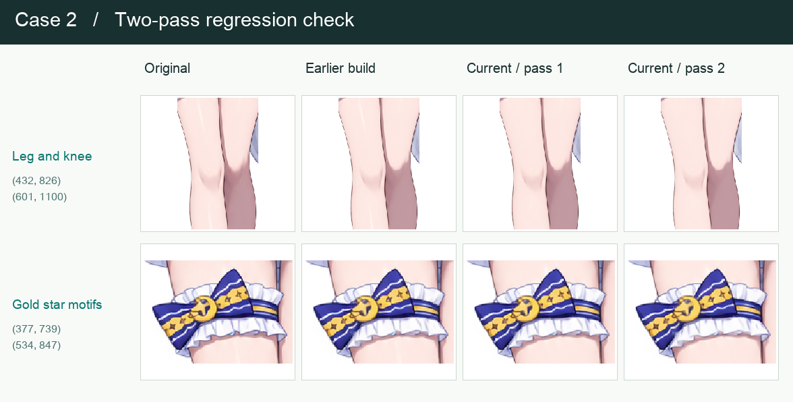
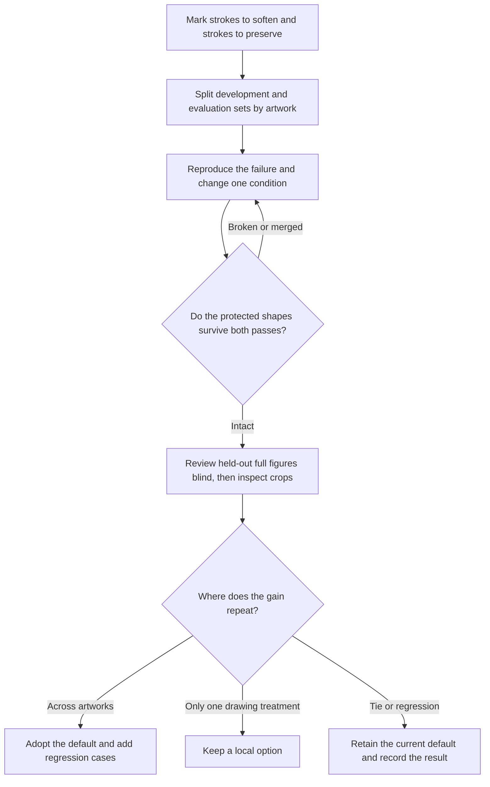

# How the renderer works and how its rules evolve

[简体中文](METHOD.md) · English

## From input to finished image

1. Read RGB and alpha separately. Identify a white paper background, a full scene, or an isolated character. White balance requires a sufficiently neutral background. The output carries the source alpha, including partially transparent edges.
2. Extract lines and regions. Estimate materials from color, brightness, position, and neighboring regions. Classify silhouettes, facial lines, material boundaries, and lines inside a material. The diagnostic maps let you inspect a classification when a fold or ornament looks wrong.
3. Separate base color, multiply shadow, screen highlight, and ink. Multiplying the base by the shadow gives diffuse color. Highlights use the remaining headroom in each channel. Ink is then composited at its own opacity.
4. Follow both sides of a fabric fold along its principal direction and taper the fold at its ends. Hair, cuffs, and belts have their own rules. A skin highlight must meet conditions for shape, surrounding color, and lighting before the renderer softens it. Inspect the knee, cast shadow, and rim light afterward.
5. Compare the provisional render with the input. Look for small ink marks, pale prints, recurring motifs, and curved metal rims that lost contrast. Restore a weighted contribution from the original layers where the evidence supports it. Case 1 matches a reviewed mask by its decoded pixels. New portraits use automatic selection.
6. Export the result, layers, masks, and report. On a second pass the report’s hashes identify the protection mask belonging to the first render. Optional denoising uses a separate local interpreter and retains the original geometric analysis.

## How reference images shape a rule

Development drew on human artwork, 122 illustrated cards, grid-based inspection, and user preferences in blind comparisons. These examples informed changes to explicit rules and review instructions. Updating a language model’s weights would require a separate training process.

An early eyelet test illustrates the distinction between a dark dot and a hole. Softening the metal highlight could leave the dot intact while erasing the rim that showed where a cord passed through. Use the same crop for the original and both passes, then trace the cord through the opening. Check an eye reflection as a negative control for accidental metal protection.

### Two regression checks

Each row uses one crop in source pixel coordinates. Read left to right from the original to an earlier build, the current first pass, and the current second pass. Pass two reads the actual first render. The earlier column comes from R5 in Case 1 and from the baseline of the skin-highlight experiment in Case 2. Compare versions within each row.

**Case 1. Count the strokes before judging the badge.** The earlier build faded two pink marks and broke the left side of the lacing. With the reviewed protection mask, both marks and the openings survive the first pass. Follow the same edges again in pass two. Automatic protection on a new character needs its own check.

**Case 2. Pair a change target with a preservation target.** Above, inspect the long highlight, the turn below the knee, and the shadow on the rear leg. Below, count the gold motifs on the garter. The first-pass report shows five candidate highlights and two selected. Pass two selected zero. The crops show whether the knee and small stars remain readable.

## Add a batch of samples

| Step | What to record |
|---|---|
| Select | Record provenance and permission. Include light and dark colors, glossy and matte surfaces, and both cutouts and full scenes. Keep crops and resized copies with their source. |
| Annotate | Record pixel coordinates, material, stroke, desired change, and what the stroke conveys. Keep differing judgments when reviewers disagree. |
| Split | Reserve whole works for evaluation before tuning. Write the acceptance criteria before viewing candidate renders. |
| Change one rule | Reproduce a failure. Save settings, both passes, and aligned crops for the baseline and candidate. |
| Check regressions | Inspect structure and alpha first, then compare full figures blind. Count improvements, ties, and regressions. Record works and crops separately. |
| Decide | Promote a change when improvements repeat across works and protected details survive. A preference specific to one collar can remain an optional local treatment. |

## Evaluate a model-assisted review

Give two assistants the same renderer, images, time budget, and review task. Record each model version, its ability to see images, and which crops it received. Have a human label structural losses, acceptable changes, and subjective preferences in advance. Count missed defects, false alarms, and appropriate requests for human inspection. Compare runs with and without the operating guide on held-out works. Matching rendered pixels measures tool reproducibility. Assessing visual judgment requires these separate observations.
